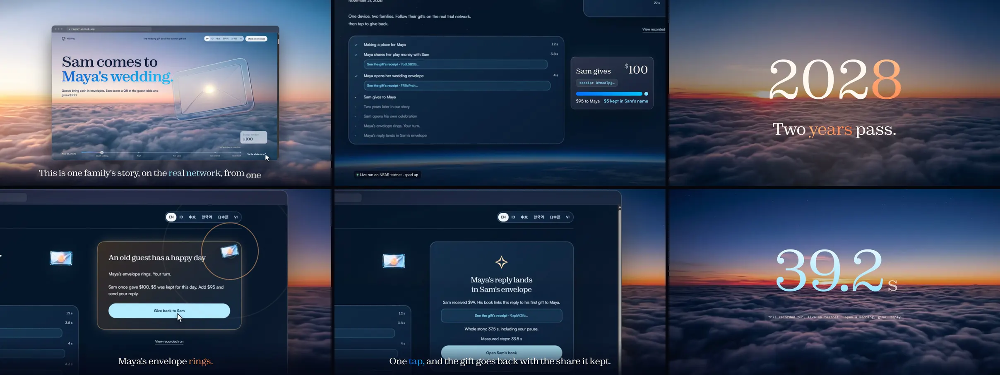
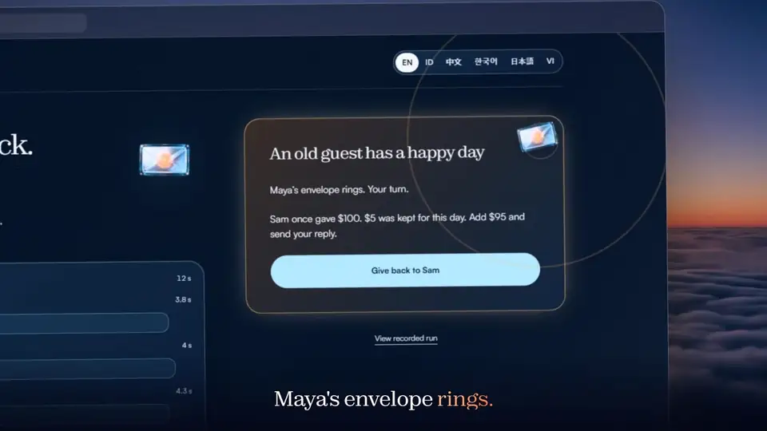
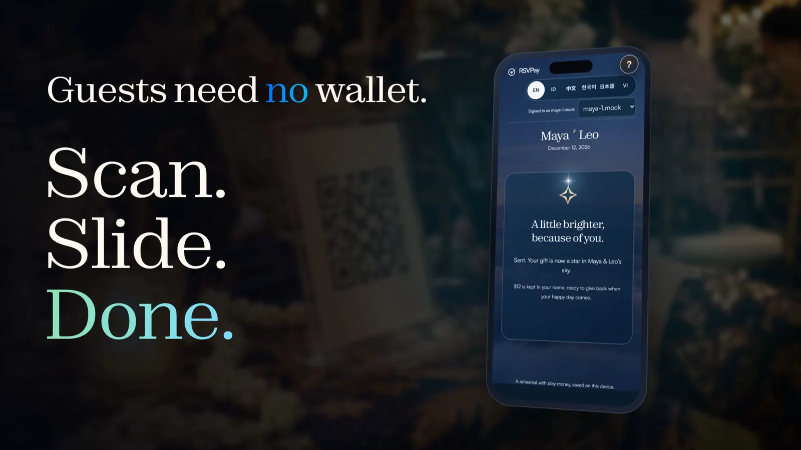
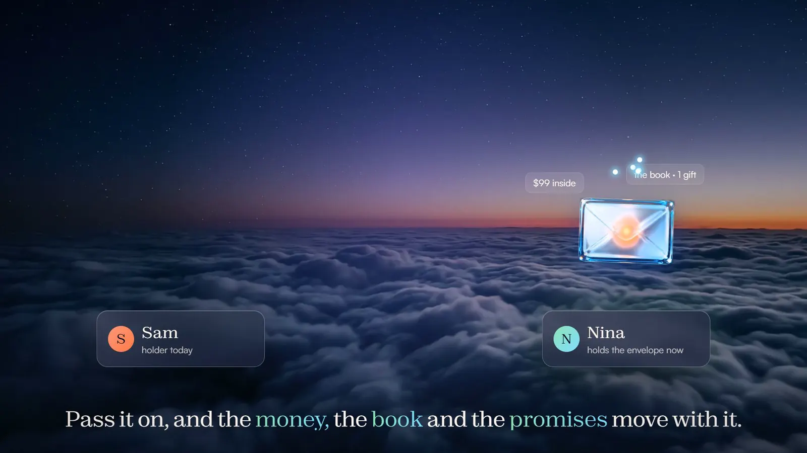
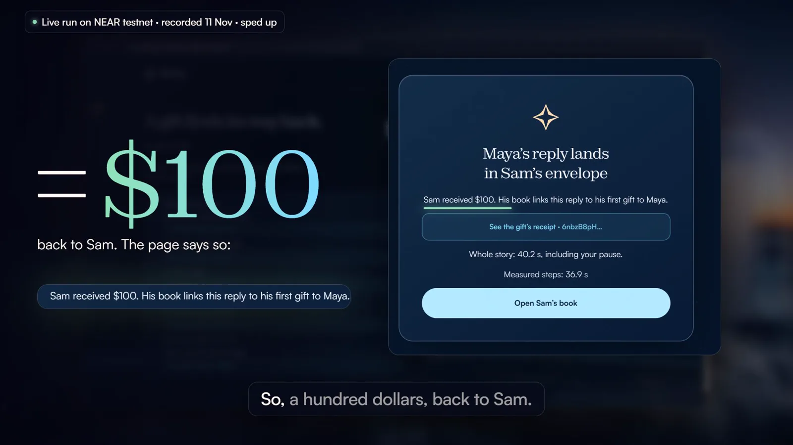
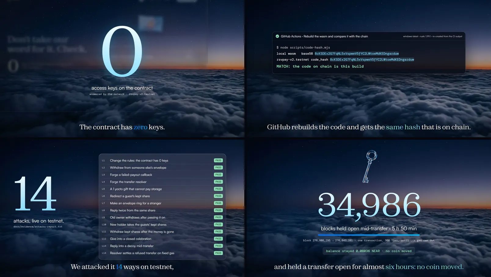

<div align="center">

<a href="https://rsvpay.xyz"></a>

# RSVPay

**A wedding gift that remembers, and gives back.**

[](https://github.com/Stylenexy/rsvpay/actions/workflows/ci.yml) [](https://github.com/Stylenexy/rsvpay/actions/workflows/sandbox.yml) [](LICENSE) [](https://testnet.nearblocks.io/address/rsvpay-v2.testnet)  

**[Try the whole story, about 40 s on testnet](https://rsvpay.xyz/#/coba)** · **[Open the site](https://rsvpay.xyz)** · **[Watch the pitch, 1 min 54 s](https://rsvpay.xyz/media/rsvpay-pitch.mp4)**

</div>

At Indonesian weddings, guests give cash in envelopes (*amplop*), and families keep a notebook of who gave what, so they can give back at the guest's own celebration years later. **The notebook gets lost. The promise goes with it.** RSVPay turns that notebook into an NFT that holds its own money and remembers. RSVP is the reply to an invitation; here the reply is a gift, years later.

Tracks: **NFTs That Do Something** + **Open Innovation**. Built at NEAR HACKATHON, November 2026. Testnet only, play money, not audited.

## For screeners and judges: what this is, and how to check it

**What it is.** RSVPay is a NEP-171 NFT contract (Rust, `near-sdk` 5.30.0) plus a React site, deployed on NEAR testnet as `rsvpay-v2.testnet`. Each wedding gets one NFT, the *envelope*. The NFT holds the gift money and a book of who gave what. A fixed part of every gift (0 to 10%, set once by the host) stays locked in the giver's name and can only be sent to that giver's own envelope, when they host their own wedding. Transfer the NFT and the money, the book and the locked shares move with it; the old holder is refused by the contract from that block on. The contract account has zero access keys, so nobody can change these rules. How each track requirement is met, including where the design differs from the example prompt, is in [Track requirements](#track-requirements-and-where-to-check-them); the limits are in [What is not solved](#what-is-not-solved).

**Code map.** The whole contract is [`contracts/src/lib.rs`](contracts/src/lib.rs) (591 lines): money per token id in `hajatans` (line 128, a map of `Hajatan` records, line 81), the holder check `require_holder` (line 407), `withdraw` (line 304) and `reciprocate` (line 250), the transfer lock around `nft_transfer_call` (lines 519-535), the payout refund `apply_withdraw_result` (line 493). Its 55 tests are [`contracts/src/tests.rs`](contracts/src/tests.rs). The site reads and writes the chain through [`frontend/src/chain/near.ts`](frontend/src/chain/near.ts).

**Check it without taking our word** (no wallet, no testnet account needed):

| Claim | Command | Expected |
|---|---|---|
| Zero access keys | the `curl` in [Try it](#try-it) | `"keys":[]` |
| Code on chain is this source | `view_account` on `rsvpay-v2.testnet` (same `curl`, with `"request_type":"view_account"`), then the CI job *Rebuild the wasm and compare it with the chain* ([its output](docs/evidence/ci-hash-match.txt), since job logs need a GitHub login) | `code_hash` `8cKSDEx2G7FqNL5xVspweV5fYC2LWtoeMdKEDngarduw`; the job prints `MATCH` (Windows, Rust 1.99.1, cargo home `C:\Users\MSI\.cargo`; other hosts build different bytes) |
| 55 contract tests | `cd contracts && cargo test` | `test result: ok. 55 passed` |
| 85 web tests | `cd frontend && npm ci && npm test`, from a clone of the whole repository (the tests also read `README.md`, `docs/` and `contracts/src/tests.rs`) | `85 passed`, `4 skipped` |
| Attacks pass on a local chain, independent of our deployment | latest [Sandbox run](https://github.com/Stylenexy/rsvpay/actions/workflows/sandbox.yml) | green; 14 attacks, 21 hold checks, 6 transfer lines |
| CI is green on the head commit | `curl -s "https://api.github.com/repos/Stylenexy/rsvpay/actions/runs?branch=master&per_page=3"` | `"conclusion": "success"` |

**Names and numbers.** RSVPay is the product. *Amplop Balas* ("reply envelope") is its first name and the contract crate; *Kado* is our own spike from the first days of this hackathon (2 November) whose escrow-per-token-id engine it reuses (see [ARCHITECTURE](docs/ARCHITECTURE.md)). Maya and Sam are Siti and Budi in the Indonesian interface and the tests. Amounts show as dollars at a demo rate of 1 NEAR = $500, so "$100" in the story is 0.2 testnet NEAR of play money. On a full clone, `git log --reverse --format='%h %ad %s' | head -1` shows the first commit, 2 November 2026 at 19:30 UTC.

**Why testnet only.** The organizers' [HACKATHON.md](https://nearhackathon.com/HACKATHON.md), Q-010: "Testnet-only projects eligible? Yes, all tracks. Mainnet only where the integration is mainnet-only." Nothing here needs a mainnet-only integration. A mainnet copy of this contract would lock about 5 NEAR of storage for the 497,654-byte wasm, which a keyless account can never recover, and the demo's account purse would hand out real money to anyone who presses the button.

## One family's story, in about 40 seconds

One button on the site runs the whole story on the real network: two families, one device, real transactions.



1. **Sam comes to Maya's wedding** and gives $100 by scanning a QR. No wallet to install.
2. **$5 of it stays locked in Sam's name.** Maya chose that share (0 to 10%) when she opened the envelope, and it can never change.
3. **Two years pass.**
4. **Sam opens his own celebration, and Maya's envelope rings:** *"Sam once gave $100. $5 was kept for this day. Add $95 and send your reply."*
5. **One tap** sends the $5 plus Maya's $95 into Sam's envelope, as a new gift linked to the old one.
6. **40.2 seconds** for the run recorded in the video, as the page itself counted it ([its log](docs/evidence/video-run-log-v2.txt)); five live runs on today's contract took 34.8 s to 41.8 s ([runs](docs/evidence/coba-e2e-runs.txt)).

The frames above come from an earlier run on 9 November ([its log](docs/evidence/video-run-log.txt)); its timer and a reply one dollar short were fixed on 11 November ([check](docs/evidence/reply-amount-check.txt)). The numbers to use are the ones in step 6.

<table>
<tr>
<td width="50%"></td>
<td width="50%"><b>The envelope rings.</b><br><br>Every reply is a gift of its own, with its own share kept, so two families can keep giving back for decades. Saying "later" changes nothing: the share waits.</td>
</tr>
<tr>
<td width="50%"><b>Guests need no wallet.</b><br><br>Scan the QR on the guest table, slide to give, done. The browser makes a testnet account on the way, on a 360 px phone too.</td>
<td width="50%"></td>
</tr>
<tr>
<td width="50%"></td>
<td width="50%"><b>The envelope is an NFT.</b><br><br>Pass it on, and the money, the book and the promises move with it. The old holder is locked out from that block on.</td>
</tr>
</table>

<div align="center">

<a href="https://rsvpay.xyz/media/rsvpay-pitch.mp4"></a>

</div>

## Don't take our word for it. Check.



| | |
|---|---|
| **0 access keys** | Nobody can change the rules, including us. [Check it yourself](#try-it) with one `curl` |
| **Same hash** | GitHub's Windows machine rebuilds the contract on every push and gets the code hash on chain ([CI](.github/workflows/ci.yml)) |
| **14 of 14** | Live attack checks on the deployed contract, all PASS: ten hostile calls refused with the state unchanged, four confirm the safe state, such as zero keys ([report](docs/evidence/attacks-report.txt), [threat model](docs/THREAT-MODEL.md)). The same script runs again on every push against that commit's wasm on a local chain ([Sandbox](.github/workflows/sandbox.yml)). A lost race prints `SKIP` instead of failing (checks L13 and P5), so count the `PASS` lines |
| **Almost six hours** | One transfer held a sale open for 34,986 blocks until its gas ran out. No coin moved ([report](docs/evidence/long-settle-max-report.txt)) |

| | |
|---|---|
| Live demo | https://rsvpay.xyz (the same deployment also answers at rsvpay.vercel.app, where the reports in `docs/evidence/` ran) |
| Contract (testnet) | [`rsvpay-v2.testnet`](https://testnet.nearblocks.io/address/rsvpay-v2.testnet), zero access keys |
| Standard | NEP-171, NEP-177, NEP-181 (`near-sdk` 5.30.0) |
| Code on chain | `8cKSDEx2G7FqNL5xVspweV5fYC2LWtoeMdKEDngarduw`. GitHub's Windows machine rebuilds this source to the same hash on every push ([CI](.github/workflows/ci.yml)) |
| Tests | 54 Rust unit tests plus one randomized test (120 random sequences, a shadow ledger matched to the yoctoNEAR after every step), 85 web, 14 live attack checks, plus live checks of a long-held transfer and a 300-gift book, and five on-chain checks of the transfer and payout paths a unit test cannot reach (P1 to P5; P4 prints two lines, so the report has six) ([report](docs/evidence/transfer-checks-report.txt)). What each one proves is in [CLAIMS.md](CLAIMS.md) |
| Docs | [Architecture](docs/ARCHITECTURE.md) · [Threat model](docs/THREAT-MODEL.md) · [Design](docs/DESIGN.md) · [Roadmap](docs/ROADMAP.md) · [Claims](CLAIMS.md) · [Changelog](CHANGELOG.md) · [Evidence](docs/evidence/) |

The project began as *Amplop Balas*, Indonesian for "reply envelope". The contract's internal crate keeps that name; the deployed account is `rsvpay-v2.testnet`.

Also by the same builder: **Mintless** (*Kota Tanpa Cetak Uang*, track Games With Real Economies), a separate project with separate code. It is named here because the rules ask each README to name the other.

## What it does

1. **A host opens a hajatan** (celebration). The contract mints one NFT, the *amplop*, to the host. The host fixes a *reply seed* of 0–10%, which can never change.
2. **A guest scans a QR and gives.** No wallet to install. The gift becomes an entry in the NFT: who, how much, the wish, when. The seed part (say 5%) stays locked in that guest's name. The rest is free for the host to withdraw.
3. **Years later the guest hosts their own hajatan.** The old amplop rings: *"Sam gave $500. Seed $25 is ready. Add $475?"* One tap releases the seed plus the top-up into Sam's amplop as a new entry linked to the old one. Saying "later" changes nothing.

Each reply is itself an entry with its own seed, so the chain of giving back can continue between two families for decades.

Words used below:

- **Envelope (amplop):** the NFT. It holds the money and the book of who gave what.
- **Celebration (hajatan):** the wedding or party an envelope belongs to.
- **Share kept (`seed` in the contract):** the part of a gift that stays locked for giving back to that guest.
- **Ring:** the signal that an old guest now has their own celebration.
- **Maya and Sam** here are the same two roles as **Siti and Budi** in the Indonesian interface, the tests and the evidence files.

## Try it

Open https://rsvpay.xyz/#/coba, or click **Try the whole story** on the landing page. The route starts immediately. No account selection or second device is needed.

The browser requests one throwaway account for Maya from a small testnet purse (`frontend/api/dana.ts`), or from NEAR's public testnet helper if the purse is empty. Maya funds Sam's sub-account from her own test balance. It then opens Maya's wedding, sends Sam's gift, advances the story date by two years and opens Sam's celebration. The chain clock is unchanged. The envelope stops at the ring until you click **Give back to Sam**.

Each completed transaction has a receipt link and a measured duration. The end shows elapsed time including your pause, plus the sum of measured steps. The target is 60 seconds; five live checks on today's contract took between 34.8 s and 41.8 s including the pause ([runs](docs/evidence/coba-e2e-runs.txt), last run in [coba-e2e-report.txt](docs/evidence/coba-e2e-report.txt)). Network latency and helper availability affect it.

If the helper refuses the request, the page says so and offers **View recorded run**. This is explicitly a past run from 3 November 2026, with the four hashes in [measured-testnet.txt](docs/evidence/measured-testnet.txt). That evidence contains opening, giving, replying and withdrawing; it does not contain Sam's opening receipt.

To watch instead of waiting on the network, open **How it works** on any inner page and press **Show me, step by step**. The site types the names, opens the book, gives, rings and gives back on its own, then says the demo is finished. That demo runs on a rehearsal client in your browser with play money, and it is labelled as a rehearsal on screen. The button above is the one that uses real testnet.

To inspect the fixed deployment's keys:

```bash
curl -s https://test.rpc.fastnear.com -H 'Content-Type: application/json' -d '{"jsonrpc":"2.0","id":1,"method":"query","params":{"request_type":"view_access_key_list","finality":"final","account_id":"rsvpay-v2.testnet"}}'
```

The read-only check on 11 November 2026 (Asia/Jakarta), at block 277,114,396, returned `"keys":[]`.

The app uses only the fixed testnet deployment `rsvpay-v2.testnet` and offers English, Indonesian, Chinese, Korean, Japanese and Vietnamese. Amounts show in rupiah in Indonesian and in dollars elsewhere, at a demo rate of 1 NEAR = Rp500.000 = $500.

| Do | See |
|---|---|
| Click **Try the whole story** on the landing page | A live timeline on `#/coba`, with both families on the same device |
| Wait for Maya's envelope to ring | Sam's original gift, the part kept for him and the amount Maya will add |
| Click **Give back to Sam** | A real reply into Sam's envelope, its transaction link and the measured elapsed time |
| Click **Open Sam's book** | The browser switches to Sam, the current holder, and opens his book |
| Read **The envelope's history** | Incoming gifts, linked replies, current holder and any verified payouts or holder changes. A history cut short by the indexer or the scan limit is labelled partial; a payout the scan never finds is not shown |
| Click **Pass the envelope on**, enter an existing testnet account and read the confirmation | The book, remaining balance and promises will all move. The old holder loses the book's controls |
| Confirm the named recipient | A real `nft_transfer` with one yoctoNEAR, a transaction link and the new holder. Switching to that holder on this device opens the inherited book |

The ordinary `#/buka`, `#/beri/<id>` and `#/buku/<id>` pages remain available for a two-device walkthrough: open a celebration, share its QR, give from the second device, then open the guest's own celebration and reply from the first device.

Accounts are throwaway testnet accounts. The browser makes the key, which stays on that device, and a small testnet purse (`frontend/api/dana.ts`) funds them. That purse's one key is a Vercel secret and guards play money only. Clearing browser storage removes access to those accounts.

History asks the public Nearblocks v3 API, without a key, for one envelope's NFT events. Those name every holder, and each holder's own calls to the contract hold the opening, sales and payouts. Every row is then checked against receipts on archival testnet RPC, because regular RPC forgets transactions after about two days. The scan reads up to six holders and 25 calls each, and labels the history partial when it hits a limit. Receipts for transactions made on this device are also saved locally and verified again when read. Failed payouts are shown as refunds, never as money paid out. Live check: [history-source-check.txt](docs/evidence/history-source-check.txt) (envelope #1, two holders, 1.27 NEAR paid out; the report prints `coverage: indexed`, its word for a scan that reached no limit).

## Track requirements and where to check them

Track **NFTs That Do Something**, from its [official prompt](https://github.com/nearai/near-hackathon-prompt-examples/blob/main/tracks/10-nfts.md). Open Innovation has no written requirements.

| Requirement | Status | Check it |
|---|---|---|
| NEP-171 contract plus logic that ties each token to its money | Done, with one difference: the money is booked per token id inside one keyless contract, **not in a sub-account per token** (see the table at the top) | [`contracts/src/lib.rs`](contracts/src/lib.rs), [how control moves](#how-control-moves-when-the-nft-is-transferred) |
| README explains how control passes and what stops the old owner | Done | [How control moves](#how-control-moves-when-the-nft-is-transferred); test `old_owner_cannot_withdraw_after_transfer`; live attack L9 |
| Gated page only current holders can open | **Partial. Not access control.** The book is hidden on screen from every account except the NFT's holder, but the holder is read from the account name stored in the browser, and the same data is readable by anyone through RPC | Steps E6b and E7 in [`e2e-report.txt`](docs/evidence/e2e-report.txt) test the screen only |
| History per NFT: earned, paid out, who held it | Implemented with partial-source disclosure. Gifts and linked replies come from chain views; payouts and holder changes come from Nearblocks v3, and every row is checked against its receipt on archival RPC | [`history.ts`](frontend/src/chain/history.ts), book history, [source checks](docs/evidence/history-source-check.txt) |
| Tests for the transfer path, including a sale in the middle of a payout | Partial: unit level (the payout result is injected into the callback helper, no purchase payment changes hands); on chain, a failed payout is refunded (P5) and a held-open transfer moves no coin | Tests `sale_during_a_payout_in_flight_keeps_every_coin_with_the_token`, `withdraw_blocked_while_sale_settles`, `sale_reverted_by_receiver_returns_amplop_and_unlocks` |
| Threat model: every way a seller could keep the money | Done | [`docs/THREAT-MODEL.md`](docs/THREAT-MODEL.md) |

## Why an NFT, not a database

| Claim | Proof |
|---|---|
| **The cycle outlives apps.** Giving back takes 5 to 20 years. This book belongs to the family, not to a company. | The book is contract state, readable with `hajatan(token_id)` without our site |
| **The money is held by the token, not by us.** No admin, no owner function, no access keys. | Live attack L1: 0 keys |
| **The rights move with the NFT.** The money, the book and the promises travel with it. The previous holder is locked out. | Step A11 in [`full-cycle-report.txt`](docs/evidence/full-cycle-report.txt), test `old_owner_cannot_withdraw_after_transfer`, live attack L9 |
| **The seed is a promise kept by code.** It can only go to the guest who gave it. | Tests `withdraw_pays_only_free_money_and_never_touches_seeds`, `reply_cannot_be_redirected_to_someone_else`; live attacks L6, L11 |

## Why NEAR

- **A contract can give up every key.** The account behind this contract has none, so the rules cannot change. That is what makes a 20-year promise believable.
- **Whoever adds data pays for its storage.** Each gift covers the storage of its own entry, so a long guest list does not fall on the host, and spam pays for itself.
- **Accounts have names.** A guest's account starts with the name they typed, like `maya-4aaqqgm.….testnet`, not a hex string, which matters when a family reads its own book.
- **The missing pieces are native.** Google login (NEAR Auth) and sponsored gas (NEP-366) are the next steps on the [roadmap](docs/ROADMAP.md), not add-ons from elsewhere.

## Run it from zero

Every command below starts from the repository root.

Needs Node 22+ and, for the contract, Rust. On Windows set `AWS_LC_SYS_PREBUILT_NASM=1` before cargo.

The same commands also run on a fresh GitHub machine in the [From zero](.github/workflows/from-zero.yml) workflow, started by hand because it uses testnet; the last run, on 11 November at commit `708c4d5`, passed every command.

None of the on-chain checks needs testnet or our deployment. On every push the [Sandbox](.github/workflows/sandbox.yml) workflow starts a local NEAR chain (near-sandbox 2.14.0, the node near-workspaces drives), deploys the wasm built from that commit, deletes its access keys as on testnet, and runs `attacks.mjs`, `long-settle.mjs` and `transfer-checks.mjs` against it unchanged: 14 attacks, 21 checks of a transfer held open, 6 lines of transfer and payout paths ([first run](docs/evidence/sandbox-run.txt)). To do the same on Linux or macOS, start `near-sandbox`, then `node scripts/sandbox.mjs <validator_key.json> <amplop_balas.wasm> root.json` and pass `NEAR_RPC` and `ATTACK_ROOT=root.json` to the scripts.

```bash
cd contracts && cargo test
```
See `test result: ok. 55 passed`: 54 unit tests and the randomized one.

```bash
cd frontend && npm ci && npm test
```
The regular suite includes pure-logic and in-memory tests. The live-network tests are skipped unless `LIVE=1`. See 85 passed, 4 skipped.

```bash
cd frontend && npm run dev
```
See a local site on http://localhost:5173, talking to the same testnet contract. Add `?mock` before the `#` to work without the network: it opens with a sample book, Maya & Leo (#1), holding three gifts and one reply waiting, so no rehearsal page starts empty.

Live checks. These use the network and make throwaway testnet accounts through NEAR's public helper. The helper rate-limits by IP: after about a dozen accounts in a morning it answered `retry in 11 hours`. If that happens, set `E2E_PARENT` or `ATTACK_ROOT` to a JSON file with `{ accountId, secret }` of a funded testnet account; the scripts explain how.

```bash
cd frontend && LIVE=1 npx vitest run src/chain/near.live.test.ts
```
In Windows PowerShell set the variable first: `$env:LIVE=1; npx vitest run src/chain/near.live.test.ts`.
See `1 passed`: the web client opens, gives, rings, replies and withdraws on testnet.

```bash
cd scripts && npm ci && node attacks.mjs
```
See 14 `PASS` lines, one per attack, against the deployed contract. Report: [`docs/evidence/attacks-report.txt`](docs/evidence/attacks-report.txt).

```bash
cd scripts && node transfer-checks.mjs
```
See `PASS` on every line: a stranger cannot move an envelope, a refused transfer leaves no lock, the resolver fits its fixed gas on its heaviest path, and a payout that really fails goes back into the envelope. The last check races an account deletion against the payout and prints `SKIP` if it loses the race four times. Report: [`docs/evidence/transfer-checks-report.txt`](docs/evidence/transfer-checks-report.txt).

```bash
cd frontend && node e2e/alur.e2e.mjs
```
See `PASS` on every line: the whole story on the live site against the deployed contract, in a real browser engine, the guest on a 360 px touch screen. Add `http://localhost:5173` to check your local build instead. The script uses a Chrome already listening on port 9333 if there is one, otherwise it starts your installed Chrome headless; on Windows set `CHROME` to the path of `chrome.exe` first. Report and screenshots: [`docs/evidence/`](docs/evidence/).

Rebuild the wasm and compare it with the code on chain (optional):

```bash
rustup target add wasm32-unknown-unknown
cd contracts && cargo build --target wasm32-unknown-unknown --release
node ../scripts/code-hash.mjs target/wasm32-unknown-unknown/release/amplop_balas.wasm
```
`.cargo/config.toml` adds `--cfg near`. Without it every on-chain panic loses its message. The script prints `MATCH` on Windows when cargo's home is `C:\Users\MSI\.cargo`, as on the machine that deployed: the panic messages of the dependencies carry that path, so it is part of the bytes. CI rebuilds it that way on every push. On Linux or macOS the hash differs for the same reason.

## How control moves when the NFT is transferred

The money lives inside the contract, booked per token id, not in anyone's account. Every money method asks one question: *who holds this NFT right now?*

- `withdraw` and `reciprocate` call `require_holder`, which reads the owner from NEP-171 state at call time. No owner is stored anywhere else.
- On `nft_transfer` the balance, the locked seeds and every entry stay with the token id, so they move with it automatically. The new holder inherits both the money and the promises. The old holder is refused from that block on.
- During `nft_transfer_call` a lock blocks `withdraw` and `reciprocate`, so a buyer cannot drain the amplop inside `nft_on_transfer` while the sale can still revert. The lock holds until the resolver runs. Only if a resolver ever failed would it let go, after about seven days, so no amplop can freeze for good. Plain `nft_transfer` follows NEP-171 and is not stopped by the lock, so a seller should send only to a buyer they trust to settle.
- A failed payout goes back into the amplop, not to the void.
- The contract account has no access keys. There is no admin, no upgrade and no pause, for us or anyone.

**Before buying an amplop**, read `hajatan(token_id)`: it is only a snapshot. The seller may withdraw free money up to the moment of sale, and no method enforces a minimum inherited balance. Seeds cannot be withdrawn by anyone; they only leave as a reply to the guest who gave them.

## What we attacked

[22 attacks](docs/THREAT-MODEL.md), each with its defence and the test that proves it. 14 checks ran for real against the deployed contract on testnet: ten are calls that must fail with the state unchanged, and four confirm the expected safe state, such as zero keys. The ones that matter most to a buyer or a guest:

| Attack | Defence | Proof |
|---|---|---|
| Seller keeps withdrawing after the sale | Holder read from NEP-171 at call time | `old_owner_cannot_withdraw_after_transfer`, live L9 |
| Buyer drains the amplop inside `nft_on_transfer`, then the sale reverts | Lock set before the transfer | `withdraw_blocked_while_sale_settles` |
| Receiver delays the resolver to drain the amplop | Lock holds until the resolver runs | `lock_holds_past_any_delay_until_the_resolver_runs` |
| A resolver fails and freezes the amplop | Lock lets go after 1,000,000 blocks; the resolver's heaviest path burnt 3.31 of its fixed 5 TGas | `a_lock_whose_resolver_never_ran_lets_go_after_the_long_bound`, live P4 |
| Host withdraws the guests' seeds | `withdraw` pays only `balance - seed_locked` | `withdraw_pays_only_free_money_and_never_touches_seeds`, live L10, L11 |
| Host sends a seed to a friend | Target must be held by the original giver | `reply_cannot_be_redirected_to_someone_else`, live L6 |
| Reply twice from one seed | Entry marked `replied` | `a_gift_can_be_replied_only_once`, live L8 |
| Forge the payout callback | `#[private]` | Live L3 |
| Payout fails and the money vanishes | Refund into the amplop | `failed_payout_refunds_into_the_amplop`, live P5 (a payout made to fail on chain) |
| A stranger moves someone else's amplop | NEP-171 owner check; a refused call leaves no lock | Live P1, P2 |
| The developer changes the rules later | Zero access keys | Live L1 |

## Measured on testnet

Reproduce the first table with `cd scripts && node measure.mjs` (see [`measured-testnet.txt`](docs/evidence/measured-testnet.txt)).

One full cycle through the web client, 3 November 2026 UTC, on the first deployment `amplop-c-mvznhnlx.testnet` (same methods; the contract moved to `rsvpay-v2.testnet` on 7 November):

| Call | Gas burnt | Fee | Transaction |
|---|---|---|---|
| `open_hajatan` | 5.47 TGas | 0.000525 NEAR | [9cDvqFm9…](https://testnet.nearblocks.io/txns/9cDvqFm9hBvdZgxFrHdL5PViAvGEtev5F1ZYYnhrwdxk) |
| `give` | 3.05 TGas | 0.000282 NEAR | [23fkWd22…](https://testnet.nearblocks.io/txns/23fkWd22hwQKgFJc8aFxJrLpQJg42PbDaX3PwL5Ci71u) |
| `reciprocate` | 3.71 TGas | 0.000349 NEAR | [53gPm5NA…](https://testnet.nearblocks.io/txns/53gPm5NADLhf6xq56p7A1Z7VmCVrkc9rvV1UCxtnuAxV) |
| `withdraw` | 5.69 TGas | 0.000502 NEAR | [CVz6QvXk…](https://testnet.nearblocks.io/txns/CVz6QvXk8Z62thL6Ed82aABjraBiCaCr3kmHxNuhSA45) |

Other measurements:

| What | Result | When | Source |
|---|---|---|---|
| Whole cycle by the web client on the first deployment: open, give, ring, reply, withdraw | 31.7 s | 3 Nov 2026 | [`web-client-live.txt`](docs/evidence/web-client-live.txt) |
| New guest gives on the live site, 360 px emulated touch screen, account made on the way | 21.3 s | 9 Nov 2026 | [`guest-check-report.txt`](docs/evidence/guest-check-report.txt) |
| Storage a gift pays for its own entry | about 0.0016 NEAR, depending on the message and the giver's name | 6 Nov 2026 UTC | Step A02 in [`full-cycle-report.txt`](docs/evidence/full-cycle-report.txt) |
| Live attack checks passed | 14 of 14 | 9 Nov 2026 | [`attacks-report.txt`](docs/evidence/attacks-report.txt) |
| Whole story on the live site, two browsers, the guest on a 360 px touch screen | 14 of 14 checks | 9 Nov 2026 | [`e2e-report.txt`](docs/evidence/e2e-report.txt) |
| A receiver holds a sale open: the amplop stays locked and refuses withdraw, reply and close, then settles | Held 404 and 409 blocks, then 34,986 blocks (5 h 50 min) until one 300 TGas transfer ran out of gas; every check passed | 9 Nov 2026 | [`long-settle-report.txt`](docs/evidence/long-settle-report.txt), [`long-settle-max-report.txt`](docs/evidence/long-settle-max-report.txt) |
| The resolver on its heaviest path: a refused transfer between two 64-character names, the sender holding only that envelope | 3.31 of its fixed 5 TGas; the envelope came back whole and unlocked | 11 Nov 2026 | [`transfer-checks-report.txt`](docs/evidence/transfer-checks-report.txt) |
| A payout made to fail on chain: the holder's account is deleted before the coins arrive | The envelope reads the same balance after the refund, to the yoctoNEAR | 11 Nov 2026 | [`transfer-checks-report.txt`](docs/evidence/transfer-checks-report.txt) |
| The ring list of a 300-gift book whose giver holds 100 envelopes | 300 of 300 read in 9.0 s | 9 Nov 2026 | [`scale-report.txt`](docs/evidence/scale-report.txt) |
| Guest pages on 360, 375 and 390 px phones: controls at least 44 px, fields 16 px, the slide on the first screen with nothing over it | 96 of 96 checks | 9 Nov 2026 | [`phone-check-report.txt`](docs/evidence/phone-check-report.txt) |

## What is not solved

Written down so nobody has to discover it. Full list: [threat model](docs/THREAT-MODEL.md#not-defended), [roadmap](docs/ROADMAP.md).

- **Amounts are public on chain.** The app hides names and amounts from non-holders, but that is a screen, not secrecy.
- **The guest's key lives in the browser.** Change phones or clear the browser and that account is gone, so the old amplop can no longer find you. **Save my key** next to the account name downloads a small file, and **Restore a key** on the new phone brings the account back. That file is full access to the test account, which is why a real product needs NEAR Auth.
- **"No wallet" still means someone funds the guest.** Here the testnet helper does. A real product needs rupiah in through QRIS, a stablecoin, and gas sponsored by a relayer. None of that is built.
- **Rupiah is a demo rate,** not a market price.
- **History depends on a free public indexer.** The page uses Nearblocks' keyless v3 API, which answers only a few calls a minute, so a busy moment can show a partial history. Chain entries and the current holder are read from the contract and never depend on it.
- **The holder gate is a screen.** The book is shown only to the browser account that holds the NFT, and that account name comes from browser storage. Reading the contract directly shows the same data. The methods that move money check the NEP-171 owner on chain.
- **A seller can empty the free money before a sale.** No method enforces a minimum balance for a buyer; read `hajatan(token_id)` just before buying. Locked shares cannot be withdrawn by anyone.
- **A locked share is a promise about where money may go, not that it will go.** Nothing forces the holder to reply, a share never expires, and the guest cannot claim it.
- **No sub-account per NFT.** Each NFT's money is a record inside one keyless contract. Transfers and settled locks use storage paid from a shared spare balance, so that balance has to last.
- **The sale-during-a-payout test is a unit test.** It injects the payout result; on chain we showed a failed payout refunded (P5) and a held-open transfer moving no coin, but not the two racing each other. Checks L13 and P5 print `SKIP` when a race is lost, without failing the run.
- **An owner's envelopes past the first 100 are not seen.** `hajatan_of` and the ring read an owner's first 100 envelopes. Nobody hosts that many; a fix needs a new deployment.
- **Not audited, and no independent users yet.** The tests above were run by the builder, and the README list also by a fresh GitHub machine.

## Repository

```text
contracts/   Rust contract and its unit tests
frontend/    React site, deployed to Vercel; e2e/ drives it in a real browser
scripts/     Testnet scripts: attacks, full cycle, demo seed
docs/        Architecture, threat model, design, roadmap, evidence
```

There is no `backend/` on purpose; the only server code is one function, `frontend/api/dana.ts`, that funds throwaway testnet accounts from a purse. See [Architecture](docs/ARCHITECTURE.md). See also [CONTRIBUTING](CONTRIBUTING.md) and [SECURITY](SECURITY.md).

## Tools and libraries

- Contract: Rust, `near-sdk` 5.30.0, `near-contract-standards`.
- Web: React 19, Vite 8, TypeScript, `near-api-js` 7.4.0, `qrcode`, `three`, GSAP. App display and body fonts: Zodiak and Satoshi; the landing also loads Figtree and DM Mono from Google Fonts.
- Tests: `cargo test`, Vitest, `playwright-core` driving an installed Chrome.
- Testnet RPC: FastNEAR. Accounts: NEAR testnet helper. Hosting: Vercel.
- AI: code and documentation were written with AI coding assistants (Claude Code, OpenAI Codex), and several AI chat assistants were consulted when choosing the idea. The landing page sky video comes from Google Flow (Veo). Photographs, envelopes, clouds and glass objects were generated with OpenAI image generation. The pitch video's narration is Dex's own voice. Its music is synthesised in code, and its sound effects are ElevenLabs Sound Effects clips from a friend's video kit. The people in its photographs were generated with OpenAI image generation; the QR in them is the site's real `#/beri/3` code. Its screen recordings are of the live site. The images in `docs/img/` are frames of the site and of the pitch videos. Listed here as the hackathon rules ask. Test counts and attack results in this README come from the commands above.

## Team

Dex Bennett (solo), Information Systems student, Universitas Kristen Duta Wacana, Yogyakarta.

## License

MIT, see [LICENSE](LICENSE).
