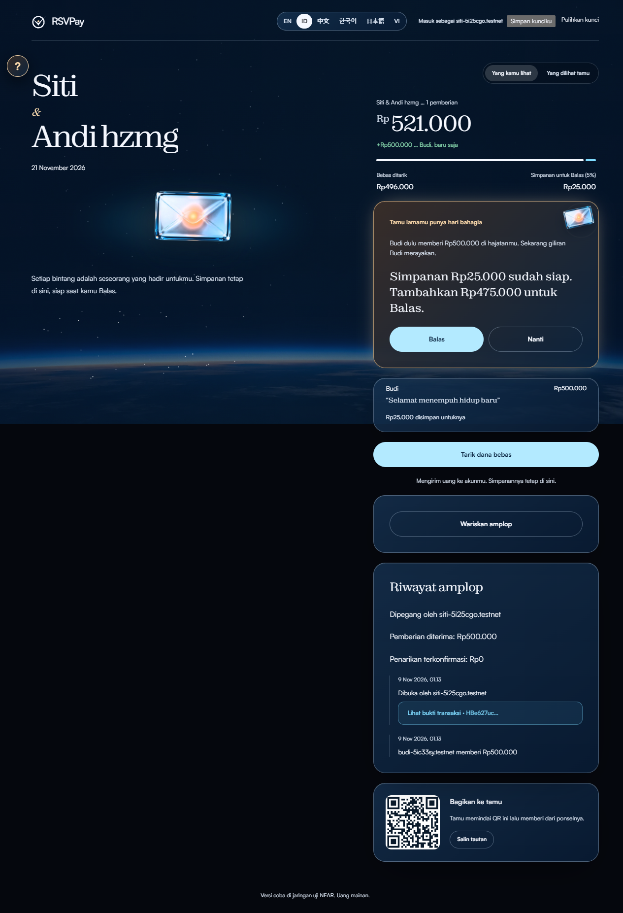

# RSVPay

**A wedding gift that remembers, and gives back.**

RSVP is the reply to a wedding invitation; here the reply is a gift, years later. The project began as *Amplop Balas*, Indonesian for "reply envelope". The contract's internal crate keeps that name; the deployed account is `rsvpay-v2.testnet`.

[](LICENSE) [](https://testnet.nearblocks.io/address/rsvpay-v2.testnet)

At Indonesian weddings, guests give money in envelopes (*amplop*) and families keep a notebook of who gave what, so they can return the favour at the guest's own celebration years later. The notebook gets lost. RSVPay makes that notebook an NFT that holds its own money and remembers.

Tracks: **NFTs That Do Something** + **Open Innovation**. Built at NEAR HACKATHON, November 2026. Testnet only, play money, not audited.

Also by the same builder: **Mintless** (*Kota Tanpa Cetak Uang*, track Games With Real Economies), a separate project with separate code. It is named here because the rules ask each README to name the other.

| | |
|---|---|
| Live demo | https://rsvpay.vercel.app |
| Contract (testnet) | [`rsvpay-v2.testnet`](https://testnet.nearblocks.io/address/rsvpay-v2.testnet), zero access keys |
| Standard | NEP-171, NEP-177, NEP-181 (`near-sdk` 5.30.0) |
| Code on chain | `8cKSDEx2G7FqNL5xVspweV5fYC2LWtoeMdKEDngarduw`. GitHub's Windows machine rebuilds this source to the same hash on every push ([CI](.github/workflows/ci.yml)) |
| Tests | 54 Rust, 80 web, 14 live attacks, plus live checks of a long-held transfer and a 300-gift book. What each one proves is in [CLAIMS.md](CLAIMS.md) |
| Docs | [Architecture](docs/ARCHITECTURE.md) · [Threat model](docs/THREAT-MODEL.md) · [Design](docs/DESIGN.md) · [Roadmap](docs/ROADMAP.md) · [Claims](CLAIMS.md) · [Changelog](CHANGELOG.md) · [Evidence](docs/evidence/) |

## What it does

1. **A host opens a hajatan** (celebration). The contract mints one NFT, the *amplop*, to the host. The host fixes a *reply seed* of 0–10%, which can never change.
2. **A guest scans a QR and gives.** No wallet to install. The gift becomes an entry in the NFT: who, how much, the wish, when. The seed part (say 5%) stays locked in that guest's name. The rest is free for the host to withdraw.
3. **Years later the guest hosts their own hajatan.** The old amplop rings: *"Sam gave $500. Seed $25 is ready. Add $475?"* One tap releases the seed plus the top-up into Sam's amplop as a new entry linked to the old one. Saying "later" changes nothing.

Each reply is itself an entry with its own seed, so the chain of giving back can continue between two families for decades.



Words used below:

- **Envelope (amplop):** the NFT. It holds the money and the book of who gave what.
- **Celebration (hajatan):** the wedding or party an envelope belongs to.
- **Share kept (`seed` in the contract):** the part of a gift that stays locked for giving back to that guest.
- **Ring:** the signal that an old guest now has their own celebration.
- **Maya and Sam** here are the same two roles as **Siti and Budi** in the Indonesian interface, the tests and the evidence files.

## Try it

Open https://rsvpay.vercel.app/#/coba, or click **Try the whole story** on the landing page. The route starts immediately. No account selection or second device is needed.

The browser requests one throwaway account for Maya from a small testnet purse (`frontend/api/dana.ts`), or from NEAR's public testnet helper if the purse is empty. Maya funds Sam's sub-account from her own test balance. It then opens Maya's wedding, sends Sam's gift, advances the story date by two years and opens Sam's celebration. The chain clock is unchanged. The envelope stops at the ring until you click **Give back to Sam**.

Each completed transaction has a receipt link and a measured duration. The end shows elapsed time including your pause, plus the sum of measured steps. The target is 60 seconds; ten live checks took between 26.9 s and 60.9 s ([runs](docs/evidence/coba-e2e-runs.txt)) including the pause, the slowest just over target, see [coba-e2e-report.txt](docs/evidence/coba-e2e-report.txt). Network latency and helper availability affect it.

If the helper refuses the request, the page says so and offers **View recorded run**. This is explicitly a past run from 3 November 2026, with the four hashes in [measured-testnet.txt](docs/evidence/measured-testnet.txt). That evidence contains opening, giving, replying and withdrawing; it does not contain Sam's opening receipt.

To watch instead of waiting on the network, open **How it works** on any inner page and press **Show me, step by step**. The site types the names, opens the book, gives, rings and gives back on its own, then says the demo is finished. That demo runs on a rehearsal client in your browser with play money, and it is labelled as a rehearsal on screen. The button above is the one that uses real testnet.

To inspect the fixed deployment's keys:

```bash
curl -s https://test.rpc.fastnear.com -H 'Content-Type: application/json' -d '{"jsonrpc":"2.0","id":1,"method":"query","params":{"request_type":"view_access_key_list","finality":"final","account_id":"rsvpay-v2.testnet"}}'
```

The read-only check on 5 November 2026 (Asia/Jakarta) returned `"keys":[]`.

The app uses only the fixed testnet deployment `rsvpay-v2.testnet` and offers English, Indonesian, Chinese, Korean, Japanese and Vietnamese. Amounts show in rupiah in Indonesian and in dollars elsewhere, at a demo rate of 1 NEAR = Rp500.000 = $500.

| Do | See |
|---|---|
| Click **Try the whole story** on the landing page | A live timeline on `#/coba`, with both families on the same device |
| Wait for Maya's envelope to ring | Sam's original gift, the part kept for him and the amount Maya will add |
| Click **Give back to Sam** | A real reply into Sam's envelope, its transaction link and the measured elapsed time |
| Click **Open Sam's book** | The browser switches to Sam, the current holder, and opens his book |
| Read **The envelope's history** | Incoming gifts, linked replies, current holder and any verified payouts or holder changes. Missing history is labelled explicitly |
| Click **Pass the envelope on**, enter an existing testnet account and read the confirmation | The book, remaining balance and promises will all move. The old holder loses the book's controls |
| Confirm the named recipient | A real `nft_transfer` with one yoctoNEAR, a transaction link and the new holder. Switching to that holder on this device opens the inherited book |

The ordinary `#/buka`, `#/beri/<id>` and `#/buku/<id>` pages remain available for a two-device walkthrough: open a celebration, share its QR, give from the second device, then open the guest's own celebration and reply from the first device.

Accounts are throwaway testnet accounts. The browser makes the key, which stays on that device, and a small testnet purse (`frontend/api/dana.ts`) funds them. That purse's one key is a Vercel secret and guards play money only. Clearing browser storage removes access to those accounts.

History asks the public Nearblocks v3 API, without a key, for one envelope's NFT events. Those name every holder, and each holder's own calls to the contract hold the opening, sales and payouts. Every row is then checked against receipts on archival testnet RPC, because regular RPC forgets transactions after about two days. The scan reads up to six holders and 25 calls each, and labels the history partial when it hits a limit. Receipts for transactions made on this device are also saved locally and verified again when read. Failed payouts are shown as refunds, never as money paid out. Live check: [history-source-check.txt](docs/evidence/history-source-check.txt) (envelope #1, two holders, 1.27 NEAR paid out, coverage complete).

## Track requirements and where to check them

Track **NFTs That Do Something**, from its [official prompt](https://github.com/nearai/near-hackathon-prompt-examples/blob/main/tracks/10-nfts.md). Open Innovation has no written requirements.

| Requirement | Status | Check it |
|---|---|---|
| NEP-171 contract plus logic that ties each token to its money | Done, with one difference: the money is booked per token id inside one keyless contract, not in a sub-account per token | [`contracts/src/lib.rs`](contracts/src/lib.rs), [how control moves](#how-control-moves-when-the-nft-is-transferred) |
| README explains how control passes and what stops the old owner | Done | [How control moves](#how-control-moves-when-the-nft-is-transferred); test `old_owner_cannot_withdraw_after_transfer`; live attack L9 |
| Gated page only current holders can open | Done at screen level: the book is hidden from anyone but the holder, while amounts stay public on chain | Steps E6b and E7 in [`e2e-report.txt`](docs/evidence/e2e-report.txt) |
| History per NFT: earned, paid out, who held it | Implemented with partial-source disclosure. Gifts and linked replies come from chain views; payouts and holder changes come from Nearblocks v3, and every row is checked against its receipt on archival RPC | [`history.ts`](frontend/src/chain/history.ts), book history, [source checks](docs/evidence/history-source-check.txt) |
| Tests for the transfer path, including a sale in the middle of a payout | Done | Tests `sale_during_a_payout_in_flight_keeps_every_coin_with_the_token`, `withdraw_blocked_while_sale_settles`, `sale_reverted_by_receiver_returns_amplop_and_unlocks` |
| Threat model: every way a seller could keep the money | Done | [`docs/THREAT-MODEL.md`](docs/THREAT-MODEL.md) |

## Why an NFT, not a database

| Claim | Proof |
|---|---|
| **The cycle outlives apps.** Giving back takes 5 to 20 years. This book belongs to the family, not to a company. | The book is contract state, readable with `hajatan(token_id)` without our site |
| **The money is held by the token, not by us.** No admin, no owner function, no access keys. | Live attack L1: 0 keys |
| **The rights move with the NFT.** The money, the book and the promises travel with it. The previous holder is locked out. | Step A11 in [`full-cycle-report.txt`](docs/evidence/full-cycle-report.txt), test `old_owner_cannot_withdraw_after_transfer`, live attack L9 |
| **The seed is a promise kept by code.** It can only go to the guest who gave it. | Tests `withdraw_pays_only_free_money_and_never_touches_seeds`, `reply_cannot_be_redirected_to_someone_else`; live attacks L6, L11 |

## Why NEAR

- **A contract can give up every key.** The account behind this contract has none, so the rules cannot change. That is what makes a 20-year promise believable.
- **Whoever adds data pays for its storage.** Each gift covers the storage of its own entry, so a long guest list does not fall on the host, and spam pays for itself.
- **Accounts have names.** A guest is `budi-….testnet`, not a hex string, which matters when a family reads its own book.
- **The missing pieces are native.** Google login (NEAR Auth) and sponsored gas (NEP-366) are the next steps on the [roadmap](docs/ROADMAP.md), not add-ons from elsewhere.

## Run it from zero

Needs Node 22+ and, for the contract, Rust. On Windows set `AWS_LC_SYS_PREBUILT_NASM=1` before cargo.

The same commands also run on a fresh GitHub machine in the [From zero](.github/workflows/from-zero.yml) workflow, started by hand because it uses testnet.

```bash
cd contracts && cargo test
```
See `test result: ok. 54 passed`.

```bash
cd frontend && npm ci && npm test
```
The regular suite includes pure-logic and in-memory tests. The live-network tests are skipped unless `LIVE=1`. See 80 passed, 4 skipped.

```bash
cd frontend && npm run dev
```
See a local site on http://localhost:5173, talking to the same testnet contract. Add `?mock` before the `#` to work without the network: it opens with a sample book, Maya & Leo (#1), holding three gifts and one reply waiting, so no rehearsal page starts empty.

Live checks. These use the network and make throwaway testnet accounts through NEAR's public helper. The helper rate-limits by IP: after about a dozen accounts in a morning it answered `retry in 11 hours`. If that happens, set `E2E_PARENT` or `ATTACK_ROOT` to a JSON file with `{ accountId, secret }` of a funded testnet account; the scripts explain how.

```bash
cd frontend && LIVE=1 npx vitest run src/chain/near.live.test.ts
```
See `1 passed`: the web client opens, gives, rings, replies and withdraws on testnet.

```bash
cd scripts && npm ci && node attacks.mjs
```
See 14 `PASS` lines, one per attack, against the deployed contract. Report: [`docs/evidence/attacks-report.txt`](docs/evidence/attacks-report.txt).

```bash
cd frontend && node e2e/alur.e2e.mjs
```
See `PASS` on every line: the whole story on the live site against the deployed contract, in a real browser engine, the guest on a 360 px touch screen. Add `http://localhost:5173` to check your local build instead. The script uses a Chrome already listening on port 9333 if there is one, otherwise it starts your installed Chrome headless; on Windows set `CHROME` to the path of `chrome.exe` first. Report and screenshots: [`docs/evidence/`](docs/evidence/).

Rebuild the wasm and compare it with the code on chain (optional):

```bash
rustup target add wasm32-unknown-unknown
cd contracts && cargo build --target wasm32-unknown-unknown --release
node ../scripts/code-hash.mjs target/wasm32-unknown-unknown/release/amplop_balas.wasm
```
`.cargo/config.toml` adds `--cfg near`. Without it every on-chain panic loses its message. The script prints `MATCH` on Windows when cargo's home is `C:\Users\MSI\.cargo`, as on the machine that deployed: the panic messages of the dependencies carry that path, so it is part of the bytes. CI rebuilds it that way on every push. On Linux or macOS the hash differs for the same reason.

## How control moves when the NFT is transferred

The money lives inside the contract, booked per token id, not in anyone's account. Every money method asks one question: *who holds this NFT right now?*

- `withdraw` and `reciprocate` call `require_holder`, which reads the owner from NEP-171 state at call time. No owner is stored anywhere else.
- On `nft_transfer` the balance, the locked seeds and every entry stay with the token id, so they move with it automatically. The new holder inherits both the money and the promises. The old holder is refused from that block on.
- During `nft_transfer_call` a lock blocks `withdraw` and `reciprocate`, so a buyer cannot drain the amplop inside `nft_on_transfer` while the sale can still revert. The lock holds until the resolver runs. Only if a resolver ever failed would it let go, after about twelve days, so no amplop can freeze for good. Plain `nft_transfer` follows NEP-171 and is not stopped by the lock, so a seller should send only to a buyer they trust to settle.
- A failed payout goes back into the amplop, not to the void.
- The contract account has no access keys. There is no admin, no upgrade and no pause, for us or anyone.

**Before buying an amplop**, read `hajatan(token_id)`: the seller may withdraw free money up to the moment of sale. Seeds cannot be withdrawn by anyone; they only leave as a reply to the guest who gave them.

## What we attacked

[17 attacks](docs/THREAT-MODEL.md), each with its defence and the test that proves it. 12 checks ran for real against the deployed contract on testnet, and each counted only if the call failed **and** the state did not change. The ones that matter most to a buyer or a guest:

| Attack | Defence | Proof |
|---|---|---|
| Seller keeps withdrawing after the sale | Holder read from NEP-171 at call time | `old_owner_cannot_withdraw_after_transfer`, live L9 |
| Buyer drains the amplop inside `nft_on_transfer`, then the sale reverts | Lock set before the transfer | `withdraw_blocked_while_sale_settles` |
| Receiver delays the resolver to drain the amplop | Lock holds until the resolver runs | `lock_holds_past_any_delay_until_the_resolver_runs` |
| A resolver fails and freezes the amplop | Lock lets go after 1,000,000 blocks | `a_lock_whose_resolver_never_ran_lets_go_after_the_long_bound` |
| Host withdraws the guests' seeds | `withdraw` pays only `balance - seed_locked` | `withdraw_pays_only_free_money_and_never_touches_seeds`, live L10, L11 |
| Host sends a seed to a friend | Target must be held by the original giver | `reply_cannot_be_redirected_to_someone_else`, live L6 |
| Reply twice from one seed | Entry marked `replied` | `a_gift_can_be_replied_only_once`, live L8 |
| Forge the payout callback | `#[private]` | Live L3 |
| Payout fails and the money vanishes | Refund into the amplop | `failed_payout_refunds_into_the_amplop` |
| The developer changes the rules later | Zero access keys | Live L1 |

## Measured on testnet

Reproduce the first table with `cd scripts && node measure.mjs` (see [`measured-testnet.txt`](docs/evidence/measured-testnet.txt)).

One full cycle through the web client, 3 November 2026 UTC:

| Call | Gas burnt | Fee | Transaction |
|---|---|---|---|
| `open_hajatan` | 5.47 TGas | 0.000525 NEAR | [9cDvqFm9…](https://testnet.nearblocks.io/txns/9cDvqFm9hBvdZgxFrHdL5PViAvGEtev5F1ZYYnhrwdxk) |
| `give` | 3.05 TGas | 0.000282 NEAR | [23fkWd22…](https://testnet.nearblocks.io/txns/23fkWd22hwQKgFJc8aFxJrLpQJg42PbDaX3PwL5Ci71u) |
| `reciprocate` | 3.71 TGas | 0.000349 NEAR | [53gPm5NA…](https://testnet.nearblocks.io/txns/53gPm5NADLhf6xq56p7A1Z7VmCVrkc9rvV1UCxtnuAxV) |
| `withdraw` | 5.69 TGas | 0.000502 NEAR | [CVz6QvXk…](https://testnet.nearblocks.io/txns/CVz6QvXk8Z62thL6Ed82aABjraBiCaCr3kmHxNuhSA45) |

Other measurements:

| What | Result | When | Source |
|---|---|---|---|
| Whole cycle by the web client: open, give, ring, reply, withdraw | 31.7 s | 3 Nov 2026 | [`web-client-live.txt`](docs/evidence/web-client-live.txt) |
| New guest gives on the live site, 360 px emulated touch screen, account made on the way | 15.3 s | 7 Nov 2026 | [`guest-check-report.txt`](docs/evidence/guest-check-report.txt) |
| Storage a gift pays for its own entry | 0.0015 NEAR | 2 Nov 2026 | Step A02 in [`full-cycle-report.txt`](docs/evidence/full-cycle-report.txt) |
| Live attacks refused | 14 of 14 | 7 Nov 2026 | [`attacks-report.txt`](docs/evidence/attacks-report.txt) |
| Whole story on the live site, two browsers, the guest on a 360 px touch screen | 13 of 13 steps | 9 Nov 2026 | [`e2e-report.txt`](docs/evidence/e2e-report.txt) |
| A receiver holds a sale open: the amplop stays locked and refuses withdraw, reply and close, then settles | Held 404 and 409 blocks, every check passed | 9 Nov 2026 | [`long-settle-report.txt`](docs/evidence/long-settle-report.txt) |
| The ring list of a 300-gift book whose giver holds 100 envelopes | 300 of 300 read in 9.0 s | 9 Nov 2026 | [`scale-report.txt`](docs/evidence/scale-report.txt) |
| Guest pages on 360, 375 and 390 px phones: controls at least 44 px, fields 16 px, the slide on the first screen with nothing over it | 96 of 96 checks | 9 Nov 2026 | [`phone-check-report.txt`](docs/evidence/phone-check-report.txt) |

## What is not solved

Written down so nobody has to discover it. Full list: [threat model](docs/THREAT-MODEL.md#not-defended), [roadmap](docs/ROADMAP.md).

- **Amounts are public on chain.** The app hides names and amounts from non-holders, but that is a screen, not secrecy.
- **The guest's key lives in the browser.** Change phones or clear the browser and that account is gone, so the old amplop can no longer find you. **Save my key** next to the account name downloads a small file, and **Restore a key** on the new phone brings the account back. That file is full access to the test account, which is why a real product needs NEAR Auth.
- **"No wallet" still means someone funds the guest.** Here the testnet helper does. A real product needs rupiah in through QRIS, a stablecoin, and gas sponsored by a relayer. None of that is built.
- **Rupiah is a demo rate,** not a market price.
- **History depends on a free public indexer.** Nearblocks retired its v1 API on 5 November 2026 and the keyless v3 API answers only a few calls a minute, so a busy moment can show a partial history. Chain entries and the current holder are read from the contract and never depend on it.
- **The holder gate is a screen.** Reading the contract directly shows the same data.
- **An owner's envelopes past the first 100 are not seen.** `hajatan_of` and the ring read an owner's first 100 envelopes. Nobody hosts that many; a fix needs a new deployment.
- **Not audited, and no independent users yet.** The tests above were run by the builder, and the README list also by a fresh GitHub machine.

## Repository

```text
contracts/   Rust contract and its unit tests
frontend/    React site, deployed to Vercel; e2e/ drives it in a real browser
scripts/     Testnet scripts: attacks, full cycle, demo seed
docs/        Architecture, threat model, design, roadmap, evidence
```

There is no `backend/` on purpose; see [Architecture](docs/ARCHITECTURE.md). See also [CONTRIBUTING](CONTRIBUTING.md) and [SECURITY](SECURITY.md).

## Tools and libraries

- Contract: Rust, `near-sdk` 5.30.0, `near-contract-standards`.
- Web: React 19, Vite 8, TypeScript, `near-api-js` 7.4.0, `qrcode`, `three`, GSAP. App display and body fonts: Zodiak and Satoshi.
- Tests: `cargo test`, Vitest, `playwright-core` driving an installed Chrome.
- Testnet RPC: FastNEAR. Accounts: NEAR testnet helper. Hosting: Vercel.
- AI: code and documentation were written with AI coding assistants (Claude Code, OpenAI Codex), and several AI chat assistants were consulted when choosing the idea. The landing page sky video comes from Google Flow (Veo). Photographs, envelopes, clouds and glass objects were generated with OpenAI image generation. Listed here as the hackathon rules ask. Test counts and attack results in this README come from the commands above.

## Team

Dex Bennett (solo), Information Systems student, Universitas Kristen Duta Wacana, Yogyakarta.

## License

MIT, see [LICENSE](LICENSE).
