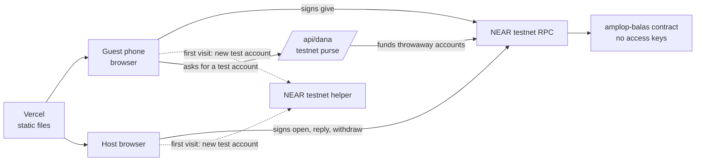

# Architecture

RSVPay has two parts and one small helper function: the contract, the static site, and `/api/dana`, which funds throwaway testnet accounts.



| Folder | What | Notes |
|---|---|---|
| `contracts/` | Rust contract, near-sdk 5.30, NEP-171/177/181 | All money and all rules live here |
| `frontend/` | React + Vite, near-api-js 7.4 | Static site. Talks to the chain directly |
| `scripts/` | Testnet scripts: attacks, full cycle, demo seed | Throwaway accounts, in-memory keys |
| `docs/` | Design, threat model, evidence | `docs/evidence/` holds run reports and screenshots |

There is no `backend/` on purpose. A backend would be one more thing that holds keys and can go down in the 5–20 years this promise has to last. The cost is that gas and account funding are not sponsored; see [Roadmap](ROADMAP.md).

## Contract

One NFT per hajatan. Money is booked per token id inside the contract.

```text
Hajatan { title, date, seed_bps, open, balance, seed_locked, entries }
Entry   { giver, amount, seed, message, at, reply_to, replied }
```

`free = balance - seed_locked`. Only `free` can be withdrawn. A seed leaves only through `reciprocate`, into a hajatan held by the guest who gave it.

| Method | Who | Effect |
|---|---|---|
| `open_hajatan(title, date, seed_bps)` | anyone | Mints the amplop to the caller. Seed 0–10%, fixed forever |
| `give(token_id, message)` | anyone, with deposit | New entry. Deposit minus storage is the gift; the seed part stays locked for this guest |
| `reciprocate(token_id, entry, to_token_id, message)` | current holder | Releases the seed plus any deposit into the guest's own hajatan as a linked entry |
| `withdraw(token_id)` | current holder | Pays all free money. Refunds into the amplop if the payout fails |
| `set_open(token_id, open)` | current holder | Opens or closes the hajatan |
| `nft_transfer`, `nft_transfer_call` | NEP-171 | Balance, seeds and entries stay with the token id |

Views: `hajatan`, `hajatan_of`, `entries`, `pending_replies`, `is_locked`, plus NEP-171/177/181. `pending_replies` is what makes an amplop "ring": unreplied gifts whose giver now holds an open hajatan.

Logs: `amplop:open`, `amplop:give`, `amplop:reply`, `amplop:withdraw`, `amplop:paid`, `amplop:payout_failed_refunded`, plus NEP-171 events.

Invariants, enforced by the tests in `contracts/src/tests.rs`:

1. `balance = free + seed_locked`.
2. The sum of unreplied seeds equals `seed_locked`.
3. Only the current holder can withdraw or reply.
4. `withdraw` never touches seeds.
5. One gift can be replied to once, and only into a hajatan held by its original giver.
6. A sale in progress (`nft_transfer_call`) blocks `withdraw`, `reciprocate` and `set_open` until the resolver runs.

## Frontend

Pages only use the `AmplopClient` interface in `frontend/src/chain/types.ts`. Two clients implement it:

- `near.ts` is the live client. It makes test accounts through the helper, keeps keys in `localStorage`, signs in the browser and polls views every 4 seconds.
- `mock.ts` enforces the same rules in memory, for tests and offline work (`?mock`).

Rupiah is display only (`lib/rupiah.ts`). The contract only knows NEAR.

## Where the code came from

Everything here was written during NEAR HACKATHON, after the announcement. The escrow pattern in the contract comes from *Kado*, our own spike from the first days of this hackathon, whose idea we dropped. It is not a fork of any earlier project.
